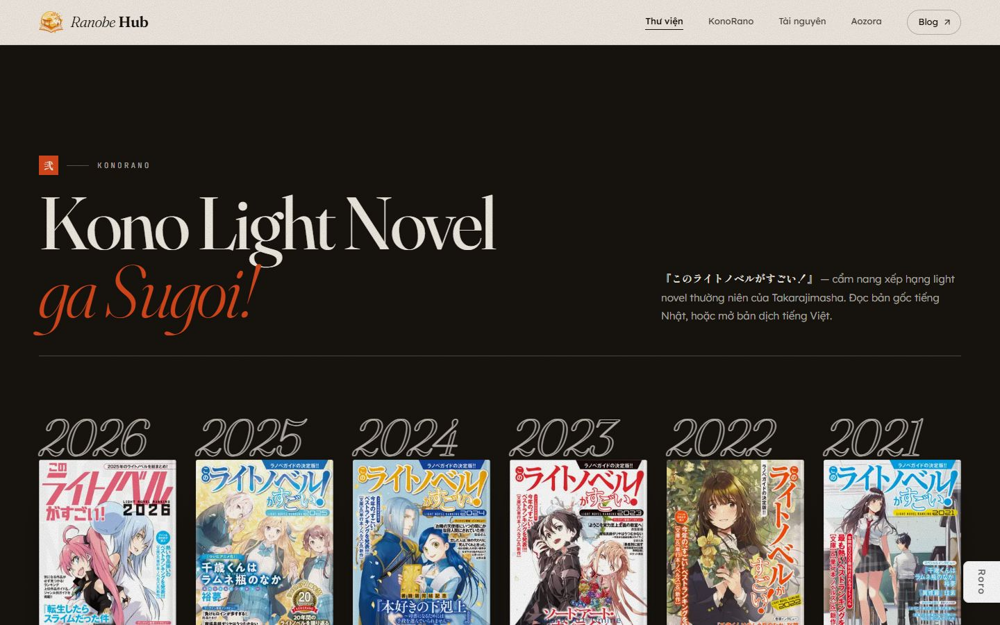
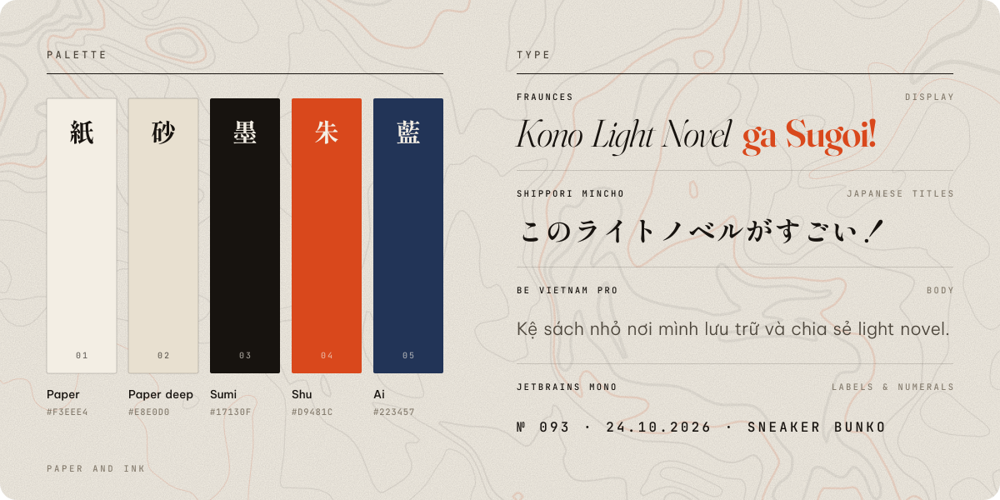

  <a href="https://hub.ranobe.vn"><b>Ranobe Hub</b></a>
  &nbsp;·&nbsp;
  <a href="https://github.com/meokisama/aozora"><b>Aozora</b></a>
  &nbsp;·&nbsp;
  <a href="https://ranobe.vn"><b>Ranobe Blog</b></a>

## About

I kept getting asked to share light novels with people, and passing files around one by one got tiring. So I built Ranobe Hub: a single, tidy shelf where anyone can browse the collection and open a book right in the browser. No download, no account.

Reading is powered by [**Aozora**](https://github.com/meokisama/aozora), an EPUB reader built for Japanese light novels.

## Features

- **Library**: fuzzy search by title, author and illustrator, publisher filters, sorting.
- **KonoRano**: every year of _Kono Light Novel ga Sugoi!_, in Japanese or Vietnamese translation.
- **Hako archive**: a searchable index of thousands of community EPUB and PDF releases.
- **Newsletter**: an email when a new book goes on the shelf.
- **Protected reader**: books are delivered encrypted with short-lived tokens, never as plain files.
- **Admin**: drop in an EPUB and the title, author and cover fill themselves in.

## Design

The whole site is set as if it were printed: warm paper, sumi ink, and a single vermilion seal for anything that asks to be pressed. Japanese titles stay in mincho, catalogue marks in mono, and section numbers use the formal numerals found on colophons: 壱, 弐, 参.

 

<picture>
  <source media="(prefers-color-scheme: dark)" srcset="./preview/art/colophon-dark.svg" />
  
</picture>

  Made with care by <a href="https://github.com/meokisama">Meoki</a> &nbsp;·&nbsp; MIT &nbsp;·&nbsp; PRs welcome

