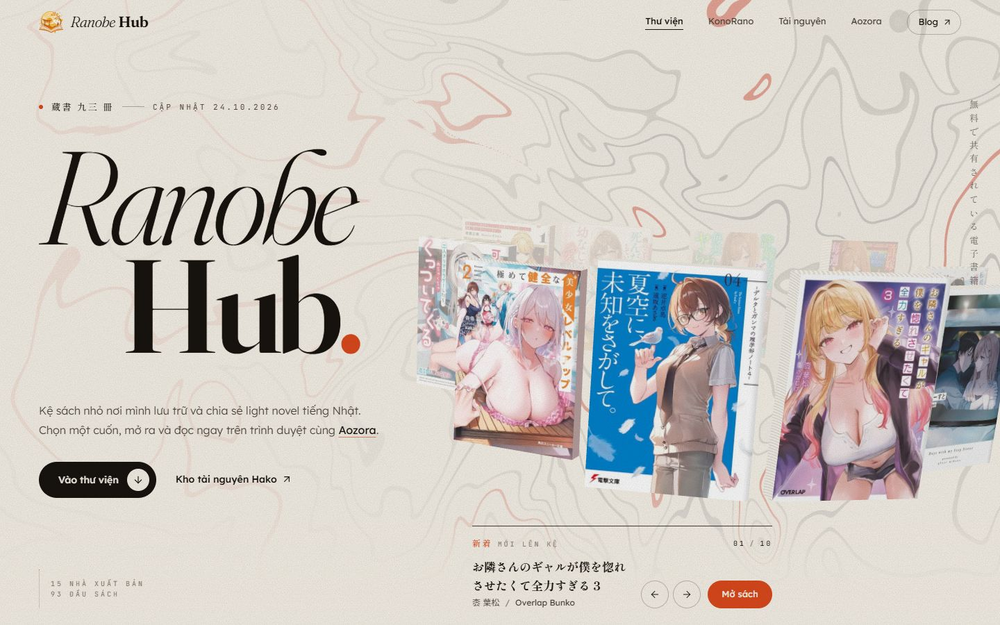
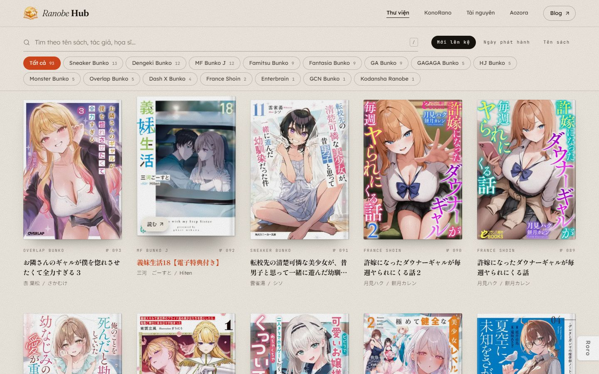

<a href="https://hub.ranobe.vn">
  
</a>

<p align="center">
  <br />
  <a href="https://hub.ranobe.vn"><b>hub.ranobe.vn</b></a>
  &nbsp;&nbsp;·&nbsp;&nbsp;
  <a href="https://github.com/meokisama/aozora">Aozora reader</a>
  &nbsp;&nbsp;·&nbsp;&nbsp;
  <a href="https://ranobe.vn">Ranobe blog</a>
  <br /><br />
</p>

<picture>
  <source media="(prefers-color-scheme: dark)" srcset="./preview/art/about-dark.svg" />
  
</picture>

<br />

I kept getting asked to share light novels with people, and passing files around one by one got tiring. So I built Ranobe Hub: a single, tidy shelf where anyone who wants to read the novels I have can browse the collection and open a book right in the browser.

Reading is powered by [**Aozora**](https://github.com/meokisama/aozora), an EPUB reader built for Japanese light novels. Ranobe Hub embeds its web port, so every book on the shelf is one click away from the first page. No download, no account.

> 無料で共有されている電子書籍 — _e-books, shared for free._

<br />

<picture>
  <source media="(prefers-color-scheme: dark)" srcset="./preview/art/tour-dark.svg" />
  
</picture>

<br />



<p align="center"><sub><b>№ 001</b> &nbsp;—&nbsp; The hero. The newest arrivals turn on a WebGL ring over ink marbling.</sub></p>



<p align="center"><sub><b>№ 002</b> &nbsp;—&nbsp; The library. Search, filter by imprint, sort, and pull a book off the shelf.</sub></p>


<p align="center"><sub><b>№ 003</b> &nbsp;—&nbsp; The KonoRano shelf. Every year of <i>Kono Light Novel ga Sugoi!</i>, side by side.</sub></p>

<br />

<picture>
  <source media="(prefers-color-scheme: dark)" srcset="./preview/art/features-dark.svg" />
  
</picture>

<br />

|  | &nbsp; | &nbsp; |
| :-: | :-- | :-- |
| **序** | **Splash & hero** | A vermilion seal lifts away into the hero, where the ten newest covers turn on a three.js ring above a suminagashi shader. Without WebGL, the same covers settle into a static fan. |
| **壱** | **Library** | Fuzzy search across title, author and illustrator (press <kbd>/</kbd> to focus), publisher chips, three sort orders, and a detail view where the book tilts under the pointer. <kbd>←</kbd> <kbd>→</kbd> step through the shelf. |
| **弐** | **KonoRano** | The yearly _Kono Light Novel ga Sugoi!_ guides, to read in the original Japanese or open in Vietnamese translation. |
| **参** | **Letters** | A postcard for the newsletter. Subscribers get an email when a new book goes on the shelf, with one-click unsubscribe. |
| **箱** | **Hako archive** | A searchable, sortable index of thousands of community EPUB and PDF releases. EPUBs open straight in the reader. |
| **空** | **Aozora** | A landing page for the reader itself, under a summer sky drawn entirely in a fragment shader. |
| **読** | **Reader delivery** | Books are never served as plain files. The reader asks for a ten-minute token bound to one title, and the EPUB travels AES-256-GCM encrypted to be decrypted in memory. |
| **管** | **Admin** | A quiet paper-and-ink back office. Drop in an EPUB and the title, author and cover fill themselves in, parsed in the browser. |

<br />

<picture>
  <source media="(prefers-color-scheme: dark)" srcset="./preview/art/design-dark.svg" />
  
</picture>

<br />

The whole site is set as if it were printed: warm paper, sumi ink, and a single vermilion seal for anything that asks to be pressed. Japanese titles stay in mincho, catalogue marks in mono, and section numbers use the formal numerals found on colophons — 壱, 弐, 参.


<br />

<picture>
  <source media="(prefers-color-scheme: dark)" srcset="./preview/art/stack-dark.svg" />
  
</picture>

<br />

| &nbsp; | &nbsp; |
| :-- | :-- |
| **Frontend** | Next.js 16 (App Router) · React 19 · TypeScript · Tailwind CSS 4 |
| **Motion & 3D** | Motion · three.js · hand-written GLSL |
| **Interface** | Radix primitives · React Hook Form · Zod · Fuse.js |
| **Backend** | Express 5 · MongoDB with Mongoose · JWT · Multer |
| **Mail** | Resend, batched and rate-limited |
| **Reader** | [Aozora](https://github.com/meokisama/aozora) web build, served by the backend at `/reader` |

```
ranobe-hub
├── frontend/              Next.js app                         → :3002
│   ├── app/(site)/        home · /resources
│   ├── app/aozora/        landing page for the reader
│   ├── app/admin/         ebooks · konorano · hako
│   ├── components/        hero, library, shelves, admin, ui
│   └── lib/               api, search, sort, epub metadata
└── backend/               Express API                         → :3001
    ├── routes/            ebooks · konoranos · hakos · publishers · subscribers · reader
    ├── models/            Mongoose schemas
    ├── uploads/           covers and epubs   (git-ignored)
    └── reader/            Aozora web build   (git-ignored)
```

Public pages are statically rendered and revalidated every six hours; the backend also pings `/api/revalidate` after an upload, so a new book shows up right away. Setting `MAINTENANCE_MODE=true` on the frontend sends every route to a holding page.

<br />

<picture>
  <source media="(prefers-color-scheme: dark)" srcset="./preview/art/setup-dark.svg" />
  
</picture>

<br />

You will need Node.js and a MongoDB instance.

**Backend**

```bash
cd backend
npm install
cp .env.example .env

# hash an admin password, then paste the result into ADMIN_PASSWORD
npm run hash-password -- "your-password"

npm run dev            # http://localhost:3001
```

**Frontend**

```bash
cd frontend
yarn
cp .env.example .env.local

yarn dev               # http://localhost:3002
```

| Variable | Where | What it does |
| :-- | :-- | :-- |
| `MONGO_URI`, `MONGO_USER`, `MONGO_PASSWORD` | backend | Database connection |
| `JWT_SECRET` | backend | Signs admin sessions and reader tokens, and derives each book's encryption key |
| `ADMIN_PASSWORD` | backend | bcrypt hash of the admin password |
| `FRONTEND_URL` | backend | Allowed CORS origin, target of revalidation pings, base of links in emails |
| `RESEND_API_KEY`, `EMAIL_FROM`, `ADMIN_EMAIL` | backend | Newsletter and notification mail |
| `REVALIDATE_SECRET` | both | Shared secret for on-demand revalidation |
| `NEXT_PUBLIC_API_URL` | frontend | Backend origin, defaults to `http://localhost:3001` |
| `NEXT_PUBLIC_GA4` | frontend | Google Analytics ID, optional |

To read books locally, drop a build of [Aozora web](https://github.com/meokisama/aozora) into `backend/reader/`. Everything else works without it.

<br />

<picture>
  <source media="(prefers-color-scheme: dark)" srcset="./preview/art/colophon-dark.svg" />
  
</picture>

<p align="center">
  <sub>Made with care by <a href="https://github.com/meokisama">Meoki</a> &nbsp;·&nbsp; MIT &nbsp;·&nbsp; PRs welcome</sub>
</p>
